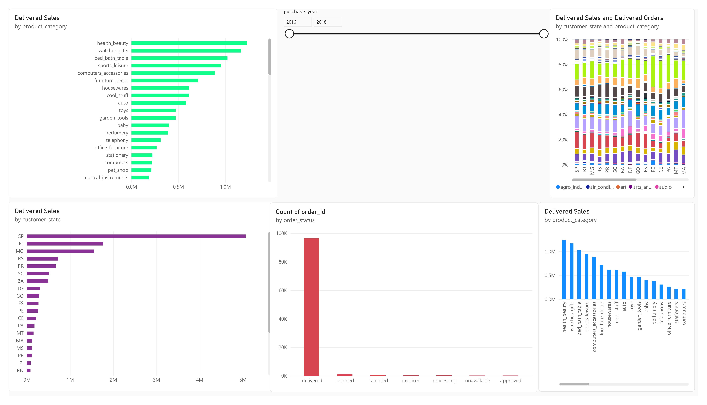

# olist-ecommerce-dwbi
 Olist e-commerce data warehouse and Power BI dashboards built with SQL Server and SSMS.
# Olist E-Commerce Data Warehouse & Power BI Dashboard

An IT3101 Data Warehousing and Business Intelligence project that turns Brazilian e-commerce order data into an SQL Server warehouse and an interactive Power BI report.

**Tools:** SQL Server · SQL Server Management Studio (SSMS) · T-SQL · Power BI Desktop

## 📊 Dashboard preview

### Executive summary

| Report page | What you can explore |
| --- | --- |
| Executive Summary | A high-level view of sales performance and key metrics |
| [Trend Analysis](03_Screenshots/03_Trend_Analysis.png) | How performance changes over time |
| [Interactive Analysis](03_Screenshots/04_Interactive_Analysis.png) | A closer look at sales across different segments using report filters |

[Download the Power BI report](04_PowerBI/OliDW.pbix) · [Browse all screenshots](03_Screenshots/)

## 🗄️ Data warehouse design

The `OlistDW` database uses separate fact tables for sales and payments. A single order can contain several items and several payments, so each process has its own grain.

| Table or view | Grain or purpose |
| --- | --- |
| `dw.FactSales` | One row per order item, with item price, freight value, and order status |
| `dw.FactPayments` | One row per payment sequence within an order, with payment type, installments, and value |
| `dw.DimDate`, `dw.DimCustomer`, `dw.DimProduct`, `dw.DimSeller` | Calendar, customer, product, and seller attributes for analysis |
| `mart.SalesAnalysis` | Reporting view that joins sales line items to their dimensions |

The SQL scripts translate product categories into English, convert purchase timestamps into reporting dates, and check warehouse row counts and key relationships.

[View the star schema](03_Screenshots/Star_Schema%20.png) · [Browse the SQL scripts](02_SQL/)

## 🛠️ Run locally

1. Download the CSVs from the [Brazilian E-Commerce Public Dataset by Olist](https://www.kaggle.com/datasets/olistbr/brazilian-ecommerce).
2. In SSMS, run [01_Create_Warehouse.sql](02_SQL/01_Create_Warehouse.sql) against a SQL Server instance to create the `OlistDW` database and warehouse tables.
3. Import the relevant CSVs into `OlistDW` as staging tables under `dbo`. Use the names referenced by the scripts: `stg_Orders`, `stg_OrderItems`, `stg_Customers`, `stg_Products`, `stg_Sellers`, `stg_CategoryTranslation`, and `stg_Payments`.
4. Use the data-cleaning scripts as applicable, then run `02_Load_Dimensions.sql` and `03_Load_FactSales.sql`. Run `04_Create_FactPayments.sql` before `05_Load_FactPayments.sql`, then run `06_Create_Sales_Mart.sql`. Use the validation queries to check the loaded tables.
5. Open [OliDW.pbix](04_PowerBI/OliDW.pbix) in Power BI Desktop. To refresh against your own SQL Server instance, update the server and database in **Data source settings** before refreshing.

## 📁 Repository contents

| Location | Contents |
| --- | --- |
| [02_SQL](02_SQL/) | Warehouse setup, data cleaning, dimension and fact loads, validation queries, and sales mart |
| [03_Screenshots](03_Screenshots/) | Power BI report pages, schema diagrams, and SSMS screenshots |
| [04_PowerBI](04_PowerBI/) | Power BI Desktop report |

## Dataset credit

The source dataset was published by Olist on Kaggle and is listed under **CC BY-NC-SA 4.0**. See the [original dataset page](https://www.kaggle.com/datasets/olistbr/brazilian-ecommerce) for details.
